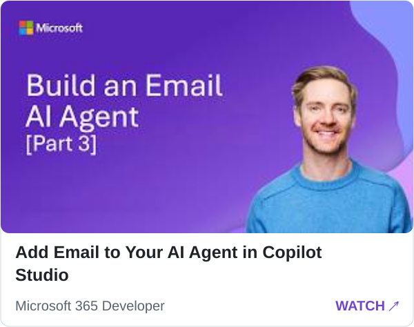
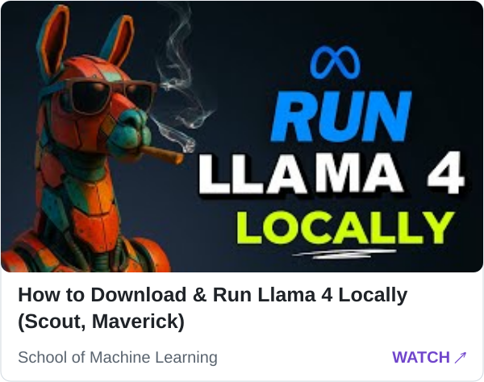
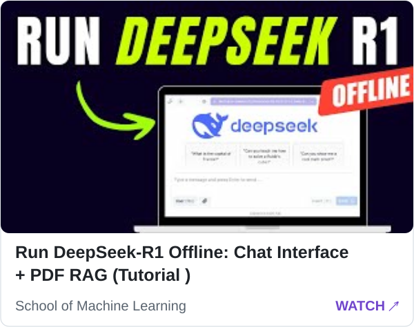

<picture>
  <source media="(prefers-color-scheme: dark)" srcset="assets/header-dark.svg">
  <source media="(prefers-color-scheme: light)" srcset="assets/header-light.svg">
  
</picture>

# Hi, I'm Farhan Hussain.

**Developer Relations Engineer · AI Developer Education**

I build AI demos, write practical guides, and help developers turn new tools into working applications.

I've created AI demos and developer education for **Microsoft Copilot Studio and Azure**.

MSc Computer Science, **Simon Fraser University** · Visual Computing

[Website](https://farhanhussain.dev) · [Microsoft tutorial](https://www.youtube.com/watch?v=3OEnY7S8YPY) · [YouTube (School of Machine Learning)](https://www.youtube.com/@SchoolofMachineLearning) · [LinkedIn](https://www.linkedin.com/in/farhan-hussain/) · [X](https://x.com/farhanleo23)

### Currently building

**[Morak.ai ↗](https://morak.ai)** — a platform for discovering and comparing voice AI tools.

### Watch and build

Selected tutorials from [my portfolio](https://farhanhussain.dev).

**Microsoft 365 Developer** · Copilot Studio

<!-- BEGIN MICROSOFT-VIDEOS -->

<a href="https://www.youtube.com/watch?v=3OEnY7S8YPY"><picture>
  <source media="(prefers-color-scheme: dark)" srcset="assets/videos/microsoft-1-dark.svg">
  
</picture></a>

<!-- END MICROSOFT-VIDEOS -->

**School of Machine Learning** · Local AI

<!-- BEGIN SCHOOL-VIDEOS -->

<a href="https://www.youtube.com/watch?v=LJMqT-FZOXs"><picture>
  <source media="(prefers-color-scheme: dark)" srcset="assets/videos/school-1-dark.svg">
  
</picture></a>
<a href="https://www.youtube.com/watch?v=BenjvaGYIwM"><picture>
  <source media="(prefers-color-scheme: dark)" srcset="assets/videos/school-2-dark.svg">
  
</picture></a>

<!-- END SCHOOL-VIDEOS -->

Featured video selection · titles and thumbnails refreshed daily.

### Explore the projects

<strong>Communication agents</strong> · Copilot Studio + Python

Build agents that take action, then connect a Python backend to an email workflow. Follow the lessons and extend the demos for your own use case.

[Lessons + code](https://github.com/farhanhussainleo/copilot-studio-series) · [Python backend](https://github.com/farhanhussainleo/ai-email-agent) · [Watch the demo](https://www.youtube.com/watch?v=3OEnY7S8YPY)

<strong>AI email responder</strong> · Azure OpenAI + Streamlit

Turn a support question into an editable draft with Azure OpenAI. Review the response, then send it with Azure Communication Services.

[Explore the code](https://github.com/farhanhussainleo/ai-customer-support-email) · [Read the walkthrough](https://techcommunity.microsoft.com/blog/azurecommunicationservicesblog/build-an-ai-email-responder-with-openai-and-azure-communication-services/4421127)

<strong>ML meets animation</strong> · Unity + Python + ONNX

An experiment connecting model predictions to character posing, bringing machine learning and inverse kinematics together with ProtoRes and FABRIK.

[Explore ProtoRes + FABRIK](https://github.com/farhanleo23/ProtoResFABRIK)

### Learn something. Build something.

- [Run DeepSeek R1 locally with Ollama](https://www.youtube.com/watch?v=LJMqT-FZOXs)
- [Build a local chat interface with PDF RAG](https://www.youtube.com/watch?v=BenjvaGYIwM)
- [Build a talking AI app with GPT, Whisper, Gradio, and ElevenLabs](https://www.schoolofmachinelearning.com/ai-conversational-app-course/)
- [Start machine learning with Python](https://www.schoolofmachinelearning.com/introduction-to-machine-learning-with-python-for-beginners/)

---

**1.5M+** YouTube views · **20K+** YouTube subscribers · **9K+** developer learning community  
**20M+** lifetime page views on **[Maypalo](https://maypalo.com)**  
Career totals across my content channels and education work.

For developer relations, technical content, or speaking: **[let's connect](https://www.linkedin.com/in/farhan-hussain/)**.
